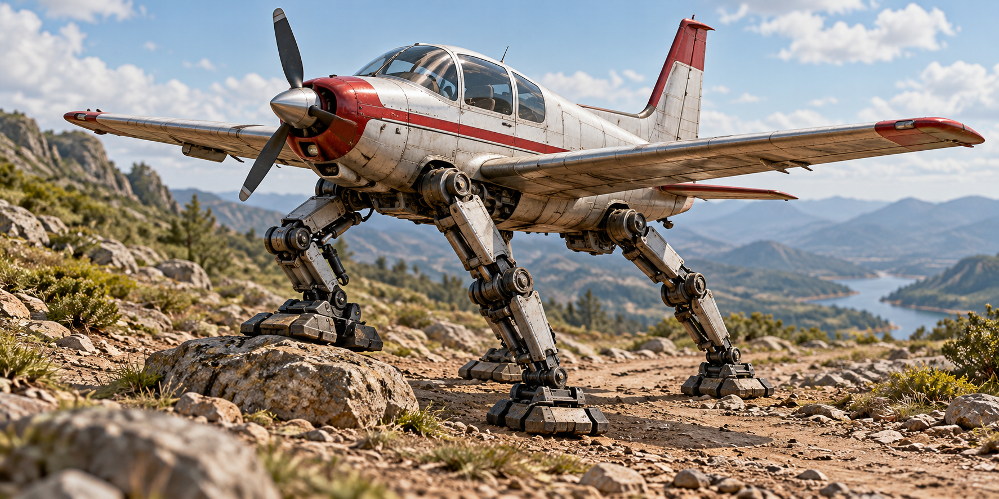

# ТЗ: шагающий самолёт «Топот»



Автор: не указан (заполнить перед сдачей).
Стихия: земля.
Проект: «Топот».
Репозиторий: https://github.com/ustithegod/crazy-vehicle
Дата заморозки: не назначена, ожидается ревью B и C.
Версия: 0.1.

## 1. Назначение

«Топот» - самолёт с кабиной для одного пилота, который передвигается на механических ногах вместо шасси. Он доставляет пилота по дороге и пересечённой местности, перешагивая невысокие препятствия. Крылья служат для равновесия; транспорт не летает и не плавает.

## 2. Стихия и конструкционный элемент

Стихия - земля. Конструкционный элемент - механические опорные ноги. Длина ног `leg_length_m` определяет максимальную высоту перешагивания: `max_step_height_m = leg_length_m * 0.5`. При повреждении ног движение и перешагивание запрещены. Число ног и устройство приводов вне контракта.

Дорога (`"road"`) и пересечённая местность (`"rough"`) - наземные поверхности. Вода (`"water"`) и воздух (`"air"`) распознаются, но движение по ним запрещено.

## 3. Публичный интерфейс

### 3.1. Модуль, класс и общие правила

Модуль `walking_plane.py`, класс `WalkingPlane`. Все исключения раздела 6 экспортируются из этого же модуля.

Числовые аргументы принимают конечные `int` и `float`, кроме `bool`. Неверный тип вызывает `TypeError`; `NaN`, бесконечности и значения вне допустимого диапазона - `ValueError`. Строковые аргументы принимают только `str`, иначе `TypeError`. Имена поверхностей чувствительны к регистру.

При любом исключении любой публичный метод сохраняет всё публичное состояние. Методы без явно указанного изменения состояния его не изменяют. Числовые результаты сравниваются с абсолютной погрешностью `1e-7`; строковые сообщения исключений не являются частью контракта.

Если несколько ошибок присутствуют одновременно, применяется описанный для метода порядок. Для одного аргумента тип проверяется раньше значения. Все числовые результаты успешных операций должны быть конечными; если вычисляемый результат не представим конечным `float`, вызывается `ValueError` без изменения состояния.

### 3.2. Конструктор

```python
def __init__(self, name: str, mass_kg: float, leg_length_m: float,
             max_speed_kmh: float, energy: float = 100.0) -> None:
```

| Аргумент | Единица | Допустимое значение |
|---|---|---|
| name | - | Строка, содержащая хотя бы один непробельный символ; сохраняется без обрезки |
| mass_kg | кг | > 0 |
| leg_length_m | м | > 0 |
| max_speed_kmh | км/ч | > 0 |
| energy | условные единицы | От 0 до 100 включительно |

Порядок проверки аргументов соответствует сигнатуре. Дополнительно проверяется конечность вычисляемого `max_step_height_m`. Исключения: `TypeError`, `ValueError` по общим правилам.

Начальное состояние: `position_km = 0.0`, `legs_intact = True`. Параметры сохраняются в одноимённых атрибутах; числовые атрибуты имеют тип `float`.

### 3.3. Атрибуты

Все перечисленные атрибуты доступны только для чтения. Попытка присваивания вызывает `AttributeError` и сохраняет состояние.

| Атрибут | Тип | Смысл |
|---|---|---|
| name | str | Имя |
| mass_kg | float | Масса в кг; информационный параметр, не влияет на расход |
| leg_length_m | float | Длина ног в м |
| max_speed_kmh | float | Скорость на дороге в км/ч |
| max_step_height_m | float | Предельная высота препятствия в м |
| energy | float | Текущая энергия, 0…100 |
| position_km | float | Суммарное пройденное расстояние в км |
| legs_intact | bool | Исправность ног |

### 3.4. Методы

#### 3.4.1. Движение

```python
def move(self, distance_km: float, terrain: str) -> float:
```

`distance_km > 0`. Возвращает время в часах: расстояние / скорость.

| terrain | Скорость | Затраты энергии |
|---|---|---|
| road | max_speed_kmh | distance_km * 2 |
| rough | max_speed_kmh * 0.5 | distance_km * 4 |

При успехе увеличивает `position_km` на расстояние, уменьшает `energy` на затраты. Остальное состояние сохраняется. Энергии ровно хватает - операция разрешена и оставляет 0. Среда между вызовами не сохраняется: каждый вызов задаёт поверхность своего участка.

Проверки: distance_km → terrain (тип и принадлежность четырём известным значениям) → запрет воды/воздуха → исправность ног → конечность расчётов времени, расхода и новой позиции → достаточность энергии.

Исключения: `TypeError`, `ValueError`; `PlaneUnsupportedTerrain` для water/air; `PlaneLegsDamaged` для повреждённых ног; `PlaneNoEnergy` при нехватке энергии.

#### 3.4.2. Расчёт расхода

```python
def calculate_energy(self, distance_km: float, terrain: str) -> float:
```

Аргументы и формулы расхода как у `move`. Возвращает расход, не меняет состояние. Проверки: distance_km → terrain → запрет воды/воздуха → конечность расхода. Не проверяет ноги, текущую энергию, время или новую позицию. Исключения: `TypeError`, `ValueError`, `PlaneUnsupportedTerrain`.

#### 3.4.3. Проверка препятствия

```python
def can_step_over(self, height_m: float) -> bool:
```

`height_m > 0`. Возвращает `True` только при исправных ногах, `height_m <= max_step_height_m` и `energy >= height_m * 10`. Иначе `False`. Не тратит энергию и не меняет состояние. Проверки: height_m → конечность расхода. Исключения: `TypeError`, `ValueError`. Доменных исключений не вызывает.

#### 3.4.4. Перешагивание

```python
def step_over(self, height_m: float) -> None:
```

`height_m > 0`. При успехе тратит `height_m * 10` энергии. Энергии ровно хватает - действие разрешено. Позиция не меняется: это локальный манёвр, длина которого в модели не учитывается. Остальные атрибуты сохраняются.

Проверки: height_m → исправность ног → допустимая высота → конечность расхода → достаточность энергии.

Исключения: `TypeError`, `ValueError`; `PlaneLegsDamaged`; `PlaneObstacleTooHigh` при высоте выше предела; `PlaneNoEnergy`. При корректном аргументе, для которого расчёт расхода конечен, результат `can_step_over` совпадает с возможностью успешного `step_over` в том же состоянии.

#### 3.4.5. Заправка

```python
def refuel(self, amount: float) -> None:
```

`amount > 0`. Увеличивает энергию до `min(100, energy + amount)`. Переполнение промежуточной суммы не является ошибкой: результат ограничен 100. Остальное состояние сохраняется. Доступна при повреждённых ногах и при энергии 100. Исключения: `TypeError`, `ValueError` при неверном аргументе.

#### 3.4.6. Повреждение и ремонт

```python
def damage_legs(self) -> None:
def repair_legs(self) -> None:
```

Устанавливают `legs_intact` соответственно в `False` и `True`. Повторный вызов допустим. Энергию не тратят, остальные атрибуты сохраняют. Исключений нет.

#### 3.4.7. Снимок состояния

```python
def get_status(self) -> dict:
```

Возвращает новый обычный словарь ровно с восемью ключами, совпадающими с именами атрибутов раздела 3.3, и их текущими значениями соответствующих типов. Изменение словаря не влияет на самолёт; последующие действия самолёта не изменяют ранее полученный словарь. Исключений нет.

## 4. Сценарии

### 4.1. Модульные примеры (AAA)

1. Дано: скорость 20, энергия 100. Вызов `move(5, "road")` возвращает 0.25; позиция 5, энергия 90.
2. Дано: скорость 20, энергия 100. Вызов `move(5, "rough")` возвращает 0.5; позиция 5, энергия 80.
3. Дано: ноги длиной 2, энергия 10. Вызов `step_over(1)` возвращает None; энергия 0, позиция 0.
4. Дано: энергия 95. Вызов `refuel(20)` возвращает None; энергия 100.

### 4.2. Сценарии через пилота (GWT)

Во всех сценариях масса 1000 кг, длина ног 2 м, скорость на дороге 20 км/ч. В начале ноги целы, позиция 0. Пилот - тестовая обёртка, делегирующая команды публичному интерфейсу; он не рассчитывает расход и не изменяет атрибуты напрямую.

#### 4.2.1. Доставка через каменный перевал

- **Given:** энергия 100.
- **When:** пилот проходит 5 км по дороге.
- **Then:** время 0.25 ч, позиция 5, энергия 90.
- **When:** проходит 3 км по пересечённой местности.
- **Then:** время 0.3 ч, позиция 8, энергия 78.
- **When:** проверяет и перешагивает камень высотой 1 м.
- **Then:** проверка True; энергия 68, позиция 8.
- **When:** проходит ещё 2 км по дороге.
- **Then:** время 0.1 ч; итог: позиция 10, энергия 64, ноги целы.

#### 4.2.2. Последние капли топлива

- **Given:** энергия 10.
- **When:** проходит 2 км по пересечённой местности.
- **Then:** время 0.2 ч, позиция 2, энергия 2.
- **When:** пытается пройти 2 км по дороге.
- **Then:** PlaneNoEnergy, всё состояние сохраняется.
- **When:** проходит 1 км по дороге.
- **Then:** время 0.05 ч, позиция 3, энергия 0.
- **When:** проверяет камень 0.5 м и пытается его перешагнуть.
- **Then:** проверка False; PlaneNoEnergy, состояние сохраняется.
- **When:** заправляется на 15 и перешагивает этот камень.
- **Then:** энергия 10, позиция 3.
- **When:** проходит 2 км по пересечённой местности.
- **Then:** время 0.2 ч; итог: позиция 5, энергия 2, ноги целы.

#### 4.2.3. Поломка у завала

- **Given:** энергия 50.
- **When:** проходит 2 км по дороге и повреждает ноги.
- **Then:** время 0.1 ч, позиция 2, энергия 46, ноги повреждены.
- **When:** проверяет камень 0.5 м, пытается идти 1 км по дороге и перешагнуть камень.
- **Then:** проверка False; обе команды вызывают PlaneLegsDamaged, состояние сохраняется.
- **When:** рассчитывает расход для 3 км rough и заправляется на 100.
- **Then:** расчёт 12 без изменения состояния; после заправки энергия 100, ноги всё ещё повреждены.
- **When:** ремонтирует ноги, перешагивает камень 0.5 м и проходит 3 км rough.
- **Then:** время движения 0.3 ч; итог: позиция 5, энергия 83, ноги целы.

#### 4.2.4. Самолёт, который не взлетел

- **Given:** энергия 40.
- **When:** пытается пройти 1 км по воде, затем 1 км по воздуху.
- **Then:** обе команды вызывают PlaneUnsupportedTerrain и сохраняют состояние.
- **When:** проверяет преграду 1.01 м и пытается её перешагнуть.
- **Then:** проверка False; PlaneObstacleTooHigh, состояние сохраняется.
- **When:** перешагивает преграду ровно 1 м.
- **Then:** энергия 30, позиция 0.
- **When:** проходит 5 км rough, заправляется на 200 и проходит 5 км road.
- **Then:** время участков 0.5 и 0.25 ч; перед заправкой энергия 10, после 100; итог: позиция 10, энергия 90, ноги целы.

### 4.3. Тест-план

`TEST_CASES.md`: 16 модульных и 4 сценарных TC, соотношение 80/20 по числу TC и тест-методов. Варианты одного правила проверяются через `subTest`. ID присутствует в имени и docstring каждого теста. Модульные проверки - AAA, сценарные - GWT. Проверяются только публичный контракт и наблюдаемое поведение.

## 5. Граничные случаи

- Ноль и отрицательные расстояние, высота, заправка запрещены.
- Энергия конструктора 0 и 100 разрешена; вне диапазона запрещена.
- Ровно достаточная энергия разрешает движение и перешагивание; меньшая запрещает без частичного выполнения.
- Высота ровно `leg_length_m / 2` разрешена, выше - запрещена.
- Заправка сверх ёмкости оставляет 100, включая очень большой конечный amount.
- bool, NaN и бесконечности не проходят числовую валидацию.
- Переполнение результатов расчётов обрабатывается по 3.1; даже при отказе позиция, энергия и исправность ног сохраняются.

## 6. Исключения

### 6.1. Иерархия

```text
Exception
└── CrazyVehicleError
    └── WalkingPlaneError
        ├── PlaneUnsupportedTerrain
        ├── PlaneLegsDamaged
        ├── PlaneObstacleTooHigh
        └── PlaneNoEnergy
```

### 6.2. Назначение

| Исключение | Условие |
|---|---|
| TypeError | Неверный тип аргумента, включая bool вместо числа |
| ValueError | Неверное значение или неконечный результат по правилам метода |
| AttributeError | Запись в публичный атрибут только для чтения |
| PlaneUnsupportedTerrain | Попытка движения или расчёта для воды/воздуха |
| PlaneLegsDamaged | Движение или перешагивание с повреждёнными ногами |
| PlaneObstacleTooHigh | Перешагивание препятствия выше предела |
| PlaneNoEnergy | Недостаточно энергии для действия |

## 7. Вне рамок

Полёт, плавание, графика, физическая симуляция равновесия, груз, пассажиры помимо пилота, износ, автоматические поломки, стоимость ремонта, карта и координаты, взаимодействие транспортов, файлы/API и сохранение состояния. Масса не участвует в формулах. Тестовый пилот не является частью поставки разработчика. Внутренние поля, алгоритмы и устройство хранения состояния не регламентируются.

## 8. Трассируемость

| Требование | Раздел | TC |
|---|---|---|
| Конструктор: значения и типы, начальное состояние, производный предел | 3.1-3.2 | 01, 02, 03 |
| Публичные атрибуты только для чтения | 3.3 | 04 |
| Движение, формулы и сохранение прочих атрибутов | 3.4.1 | 05, 06 |
| Валидация, приоритеты, атомарность движения | 3.4.1 | 07, 08 |
| Точная граница и нехватка энергии | 3.4.1, 5 | 06, 08 |
| Расчёт расхода независимо от состояния | 3.4.2 | 09 |
| Проверка препятствий без изменения состояния | 3.4.3 | 10 |
| Перешагивание, предел высоты, расход | 3.4.4 | 11, 12 |
| Валидация высоты, приоритеты и атомарность отказов | 3.4.3-3.4.4 | 10, 12 |
| Заправка, валидация и ограничение ёмкости | 3.4.5 | 13 |
| Повреждение/ремонт и повторные вызовы | 3.4.6 | 14 |
| Снимок, типы и независимость словаря | 3.4.7 | 15 |
| Иерархия доменных исключений | 6 | 16 |
| Конечность расчётов и граничные случаи | 3.1, 5 | 02, 03, 07, 09, 10, 12, 13 |
| Доставка через каменный перевал | 4.2.1 | 17 |
| Последние капли топлива | 4.2.2 | 18 |
| Поломка у завала | 4.2.3 | 19 |
| Самолёт, который не взлетел | 4.2.4 | 20 |

Номера в таблице обозначают TC-01…TC-20 из TEST_CASES.md.

## 9. Открытые вопросы

Вопросы для обсуждения до заморозки ТЗ. До принятия изменений действуют правила раздела 3; разработчик не должен выбирать поведение самостоятельно.

1. Должна ли масса самолёта влиять на расход энергии? Сейчас расход зависит только от расстояния и поверхности, а масса является информационным параметром.
2. Нужно ли учитывать продвижение при перешагивании препятствия в `position_km`? Сейчас перешагивание считается локальным манёвром и не увеличивает пройденное расстояние.
3. Должен ли ремонт ног требовать энергии? Сейчас ремонт бесплатный и доступен даже при пустом баке, поэтому после поломки можно восстановить ноги без заправки.
